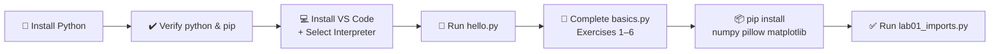
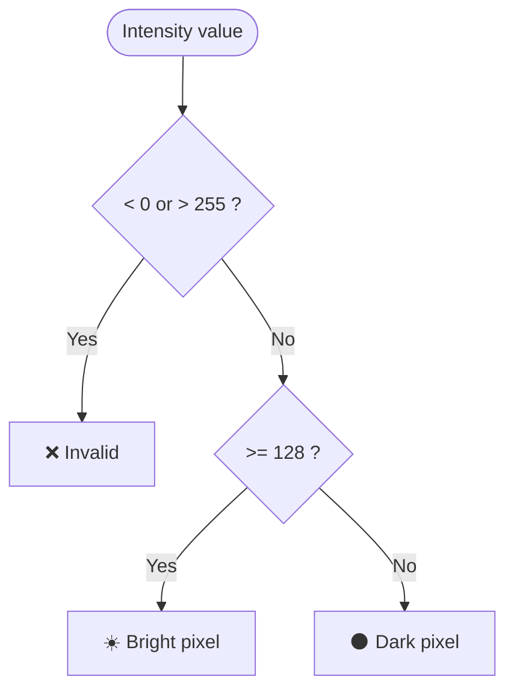

<div align="center">

# 🖼️ Digital Image Processing Lab

### Lab 01 · Python Setup, Fundamentals & Imports


**A hands-on introduction to Python for Digital Image Processing, using pixel-based examples.**

[Overview](#-overview) · [Structure](#-repository-structure) · [Quick Start](#-quick-start) · [Exercises](#-exercises) · [Output](#-sample-output) · [Packages](#-packages)

</div>

---

## 📌 Overview

This repository contains my solution for **Lab Task 01** of the *Digital Image Processing* course. The lab covers setting up a Python development environment and practising the core language features that image-processing code relies on, all through simple pixel-intensity examples.

| | |
|---|---|
| 🎓 **University** | The University of Azad Jammu and Kashmir |
| 🏫 **Department** | Software Engineering |
| 📚 **Course** | Digital Image Processing Lab |
| 👨‍🏫 **Instructor** | Engr. Fahad Nisar |
| 📅 **Semester / Session** | Fifth · 2024-28 (SE) |
| 👤 **Student** | Shahzad Ahmed Awan ([@ShahzadAhmedAwan](https://github.com/ShahzadAhmedAwan)) |
| 🗓️ **Assigned → Due** | October 16, 2026 → October 23, 2026, 11:59 PM |

---

## 🎯 Objectives

- ✅ Install Python and VS Code, and select the correct interpreter
- ✅ Verify `python` and `pip` from Command Prompt
- ✅ Practise variables, conditions, loops, functions and collections
- ✅ Install **NumPy**, **Pillow** and **Matplotlib**
- ✅ Verify the required import statements run without errors

---

## 📁 Repository Structure

```text
dip-lab-01/
├── 📄 hello.py            # Step 4  · First Python program
├── 📄 basics.py           # Step 5  · Exercises 1–6
├── 📄 lab01_imports.py    # Step 8  · Package import check
└── 📄 README.md           # You are here
```

| File | Purpose |
|---|---|
| [`hello.py`](hello.py) | Prints `Hello, Digital Image Processing!` to confirm Python works |
| [`basics.py`](basics.py) | Six labeled exercises covering the Python fundamentals |
| [`lab01_imports.py`](lab01_imports.py) | Imports NumPy, Pillow and Matplotlib; produces no output when successful |

---

## 🗺️ Lab Workflow



---

## 🚀 Quick Start

> **Requirements:** Windows, an internet connection, and permission to install software. Commands below are for **Command Prompt**.

**1. Verify Python and pip**

```bat
python --version
python -m pip --version
```

**2. Clone this repository**

```bat
git clone https://github.com/ShahzadAhmedAwan/dip-lab-01.git
cd dip-lab-01
```

> 💡 Replace `dip-lab-01` with your actual repository name if it differs.

**3. Install the required packages**

```bat
python -m pip install numpy pillow matplotlib
python -m pip show numpy pillow matplotlib
```

**4. Run the programs**

```bat
python hello.py
python basics.py
python lab01_imports.py
```

---

## 🧪 Exercises

All six exercises live in [`basics.py`](basics.py) and share a small `print_separator()` helper so the terminal output is easy to read.

| # | Topic | What it demonstrates | Result |
|:-:|---|---|---|
| 1 | **Variables & Data Types** | `int`, `str`, `bool`, `type()`, and `width * height` | `307200` pixels |
| 2 | **`if` / `elif` / `else`** | Classifying intensities, including the boundary values | `Invalid` · `Dark` · `Bright` |
| 3 | **`for` & `while` Loops** | Iterating a list; counting 0 → 2 with a counter update | 3 labels · counter `0, 1, 2` |
| 4 | **Functions** | `is_bright(pixel, threshold=128)` with a default argument | `False`, `True`, `False` |
| 5 | **Lists & Tuples** | Indexing, item replacement, `append`, tuple unpacking | `[0, 150, 255, 64]` · length `4` |
| 6 | **Dictionaries & Sets** | Key access, adding a key, de-duplication with `set` | `3` unique labels |

### 🎚️ Pixel intensity logic (Exercise 2)



Boundary tests used: **-1, 0, 127, 128, 255, 256**

| Intensity | -1 | 0 | 127 | 128 | 255 | 256 |
|---|:-:|:-:|:-:|:-:|:-:|:-:|
| **Label** | ❌ Invalid | 🌑 Dark | 🌑 Dark | ☀️ Bright | ☀️ Bright | ❌ Invalid |

### 🔒 Mutability: list vs tuple (Exercise 5)

| | **List** `[ ]` | **Tuple** `( )` |
|---|:-:|:-:|
| Change an item | ✅ | ❌ |
| Add / remove items | ✅ | ❌ |
| Mutable | ✅ | ❌ |
| Example | `pixels[1] = 150` | `size = (640, 480)` |

A list is **mutable**, so its items can be reassigned, added or removed in place. A tuple is **immutable**, so its structure and items are fixed once it is created.

---

## 🖥️ Sample Output

<details>
<summary><b>👋 hello.py</b></summary>

```text
Hello, Digital Image Processing!
```
</details>

<details open>
<summary><b>🧮 basics.py</b> (click to collapse)</summary>

```text
--------------- Exercise 1: Variables & Data Types ---------------
Variable 'width'      : 640         | Type: <class 'int'>
Variable 'height'     : 480         | Type: <class 'int'>
Variable 'image_name' : sample.png  | Type: <class 'str'>
Variable 'is_color'   : True        | Type: <class 'bool'>

Total calculated pixels (width * height): 307200

--------------- Exercise 2: if, elif, and else ---------------
Intensity  -1 : Invalid
Intensity   0 : Dark pixel
Intensity 127 : Dark pixel
Intensity 128 : Bright pixel
Intensity 255 : Bright pixel
Intensity 256 : Invalid

--------------- Exercise 3: for and while Loops ---------------
For loop (threshold = 128):
  Value  20 : Dark pixel
  Value 130 : Bright pixel
  Value 255 : Bright pixel

While loop (counts 0 to 2):
  Counter : 0
  Counter : 1
  Counter : 2

--------------- Exercise 4: Functions ---------------
is_bright(127)      : False
is_bright(128)      : True
is_bright(200, 210) : False

--------------- Exercise 5: Lists and Tuples ---------------
Original list       : [0, 128, 255]
First item          : 0
Modified list       : [0, 150, 255, 64]
Total list length   : 4

Unpacked Tuple      : Width = 640, Height = 480

--------------- Exercise 6: Dictionaries and Sets ---------------
Original dictionary : {'width': 640, 'height': 480}
Modified dictionary : {'width': 640, 'height': 480, 'mode': 'RGB'}
Width (by key)      : 640
Mode (by key)       : RGB

Original list       : ['cat', 'dog', 'cat', 'bird']
Unique labels count : 3
```

> ℹ️ Set display order may vary between runs; only the unique count (`3`) matters.
</details>

<details>
<summary><b>📦 lab01_imports.py</b></summary>

```text
(no output: the file only contains imports, so it finishes silently)
```
</details>

---

## 📦 Packages

```python
import numpy as np
from PIL import Image
import matplotlib.pyplot as plt
```

| Package | Install name | Role in image processing |
|---|---|---|
| 🔢 **NumPy** | `numpy` | Numerical arrays; an image is essentially a 2D/3D array of pixel values |
| 🖼️ **Pillow** | `pillow` | Opening, converting and saving images (`from PIL import Image`) |
| 📊 **Matplotlib** | `matplotlib` | Displaying images and plotting results such as histograms |

---

## 🐍 Python vs pip

| | **Python** | **pip** |
|---|---|---|
| What it is | The programming language and its interpreter | Python's package installer |
| What it does | Runs your `.py` files | Downloads and installs libraries such as NumPy |
| Check with | `python --version` | `python -m pip --version` |

The **import statements** make an installed package available inside a script. If `lab01_imports.py` runs without errors, the three packages are installed correctly and ready for the next labs.

---

## ✅ Submission Checklist

- [x] `hello.py`, `basics.py` and `lab01_imports.py` written
- [x] All six exercises produce the expected results
- [ ] Screenshots: Python/pip versions, VS Code interpreter, `hello.py`, all exercises, package details, import run
- [ ] Report named `2024-SET-<ROLL_NO>.docx` or `.pdf`, with name and roll number at the top
- [ ] Short explanation of Python vs pip and the purpose of the imports

---

## 📜 Academic Integrity

This is my own work for the lab assignment. Copying or sharing work results in zero credit for everyone involved, so please use this repository for reference and learning only.

---

<div align="center">

### 👨‍💻 Author

**Shahzad Ahmed Awan**
Software Engineering · UAJK · Session 2024-28

[](https://github.com/ShahzadAhmedAwan)

*Guided by **Engr. Fahad Nisar** · Digital Image Processing Lab*

⭐ If this helped you, consider starring the repo!

</div>
