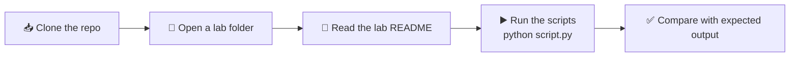

<div align="center">

# 🖼️ Digital Image Processing Lab

### Lab Work, Assignments & Notes · Software Engineering, UAJK


-informational?style=flat-square)


**One repository for every lab of the Digital Image Processing course, organized, documented and reproducible.**

[About](#-about) · [Lab Index](#-lab-index) · [Structure](#-repository-structure) · [Setup](#-environment-setup) · [Usage](#-how-to-use-this-repo) · [Author](#-author)

</div>

---

## 📌 About

This repository collects my work for the **Digital Image Processing Lab** course. Each lab lives in its own folder with its own code and a dedicated README, so the repository grows lab by lab while staying easy to navigate.

| | |
|---|---|
| 🎓 **University** | The University of Azad Jammu and Kashmir |
| 🏫 **Department** | Software Engineering |
| 📚 **Course** | Digital Image Processing Lab |
| 👨‍🏫 **Instructor** | Engr. Fahad Nisar |
| 📅 **Semester / Session** | Fifth · 2024-28 (SE) |
| 👤 **Student** | Shahzad Ahmed Awan ([@ShahzadAhmedAwan](https://github.com/ShahzadAhmedAwan)) |

---

## 🧭 Lab Index

| Lab | Title | Topics | Status | Link |
|:-:|---|---|:-:|:-:|
| **01** | Python Setup, Fundamentals & Imports | Python and VS Code setup, variables, conditions, loops, functions, lists, tuples, dictionaries, sets, NumPy / Pillow / Matplotlib imports | ✅ Completed | [Open](./dip-lab-01) |
| **02** | _To be added_ | | ⏳ Upcoming | |
| **03** | _To be added_ | | ⏳ Upcoming | |
| **04** | _To be added_ | | ⏳ Upcoming | |

> 📝 This table is updated as each new lab is assigned and completed.

---

## 📁 Repository Structure

```text
digital-image-processing-lab/
├── 📂 dip-lab-01/              # Lab 01 · Python setup & fundamentals
│   ├── hello.py
│   ├── basics.py
│   ├── lab01_imports.py
│   └── README.md
│
├── 📂 dip-lab-02/              # (coming soon)
├── 📂 dip-lab-03/              # (coming soon)
│
└── 📄 README.md                # You are here
```

**Convention:** every lab folder is named `dip-lab-XX`, contains its own scripts, and has a `README.md` describing the task, how to run it, and its expected output.

---

## 🛠️ Tech Stack

| Tool | Purpose |
|---|---|
| 🐍 **Python 3** | Main programming language for all labs |
| 💻 **VS Code** | Editor, with the Python extension by Microsoft |
| 🔢 **NumPy** | Numerical arrays; images are stored as arrays of pixel values |
| 🖼️ **Pillow (PIL)** | Opening, converting and saving images |
| 📊 **Matplotlib** | Displaying images and plotting results |
| 🌿 **Git & GitHub** | Version control and hosting |

---

## ⚙️ Environment Setup

> **Requirements:** Windows, an internet connection, and permission to install software. Commands are for **Command Prompt**.

**1. Check Python and pip**

```bat
python --version
python -m pip --version
```

**2. Clone the repository**

```bat
git clone https://github.com/ShahzadAhmedAwan/digital-image-processing-lab.git
cd digital-image-processing-lab
```

> 💡 Replace `digital-image-processing-lab` with your actual repository name if it differs.

**3. Install the required packages**

```bat
python -m pip install numpy pillow matplotlib
python -m pip show numpy pillow matplotlib
```

**4. Select the interpreter in VS Code**

Press `Ctrl + Shift + P`, choose **Python: Select Interpreter**, and pick your installed Python 3.

---

## ▶️ How to Use This Repo



Run any lab from inside its folder, for example:

```bat
cd dip-lab-01
python hello.py
python basics.py
python lab01_imports.py
```

---

## 🧰 Quick Command Reference

| Task | Command |
|---|---|
| Check Python version | `python --version` |
| Check pip version | `python -m pip --version` |
| Install a package | `python -m pip install <package>` |
| Show package details | `python -m pip show <package>` |
| Run a script | `python <file>.py` |
| Pull latest changes | `git pull` |

---

## 📜 Academic Integrity

This repository contains my own work for the lab assignments. Copying or sharing work can result in zero credit for everyone involved, so please use it for reference and learning only, and write your own solutions.

---

<div align="center">

## 👨‍💻 Author

**Shahzad Ahmed Awan**
Software Engineering · UAJK · Session 2024-28

[](https://github.com/ShahzadAhmedAwan)

*Guided by **Engr. Fahad Nisar** · Digital Image Processing Lab*

⭐ If this repo helped you, consider giving it a star!

</div>
