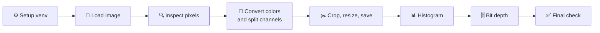
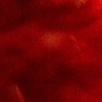
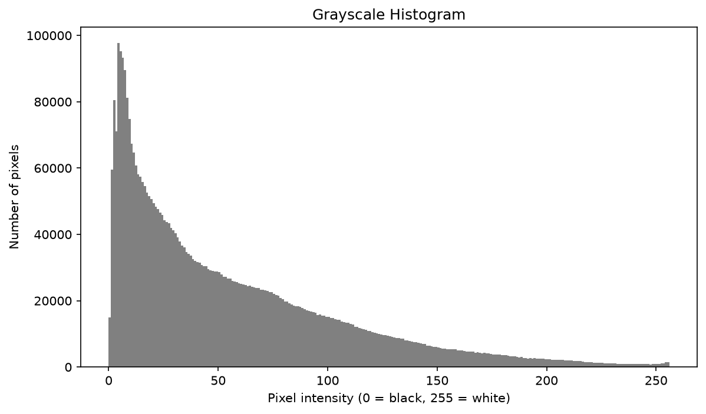

<h1 align="center">🖼️ Digital Image Processing — Lab Task 02</h1>
<h3 align="center">Digital Images, Pixels, Color, and Basic Transformations</h3>

<p align="center">
  
  
  
  
</p>

<p align="center">
  
  
  
  
  
  
</p>

**Name:** Shahzad Ahmed Awan  
**Roll No.:** 2024-SET-XXX

---

## 📌 Overview

This lab uses **NumPy**, **OpenCV**, and **Matplotlib** to load, inspect, display, analyze, transform, and save a digital image. It covers pixel coordinates, color channels, grayscale conversion, cropping, resizing, histograms, resolution, and bit depth.

As approved by the instructor (Engr. Fahad Nisar), the lab is implemented as a Jupyter notebook (`lab02.ipynb`) instead of a `lab02.py` script.

---

## 🔄 Workflow



---

## 🗂️ Project Structure

```
dip-lab-02/
├── .venv/                      virtual environment (not submitted)
├── .gitignore                  excludes .venv/
├── lab02.ipynb                 main lab notebook
├── my_image.jpeg               input image
├── resized_crop.png            output: 200 x 200 resized crop
├── grayscale_histogram.png     output: grayscale histogram
└── README.md
```

---

## 🧰 Requirements

| Item | Version used |
|---|---|
| 🐍 Python | 3.14 |
| 🔢 NumPy | 2.5.4 |
| 👁️ OpenCV (`opencv-python`) | 5.0.0 |
| 📈 Matplotlib | 3.11.2 |
| 📓 Jupyter support | VS Code Jupyter extension (`ipykernel`) |

---

## ⚙️ Setup

**1. Create the project folder and virtual environment**

```
mkdir dip-lab-02
cd dip-lab-02
python -m venv .venv
```

**2. Activate the environment**

| Shell | Command |
|---|---|
| Command Prompt | `.venv\Scripts\activate.bat` |
| PowerShell | `.venv\Scripts\Activate.ps1` |

**3. Install the libraries**

```
pip install numpy opencv-python matplotlib ipykernel
```

**4. Exclude the environment from Git**

```
echo .venv/ > .gitignore
```

---

## ▶️ How to Run

1. Open the `dip-lab-02` folder in VS Code.
2. Place the input image in the folder and make sure `IMAGE_PATH` in the notebook matches its file name (default: `my_image.jpeg`). The image must be at least 300 x 300 pixels.
3. Open `lab02.ipynb` and select the `.venv` kernel (top right).
4. Click **Restart → Run All**.
5. When finished, run `deactivate` in the terminal.

---

## 🧪 What the Notebook Does

| Step | Task | Result |
|---|---|---|
| 1️⃣ | Verify environment | Python path, virtual-env status, library versions, `.gitignore` check |
| 2️⃣ | Load the image | Shape and data type, with a missing-file and minimum-size check |
| 3️⃣ | Inspect the image | Height, width, channels, top-left and center pixels, min/max values |
| 4️⃣ | Convert colors and split channels | Six labeled views and the center pixel's RGB and HEX value |
| 5️⃣ | Crop, resize, and save | 100 x 100 center crop enlarged to 200 x 200, saved as `resized_crop.png` |
| 6️⃣ | Histogram | Grayscale histogram saved as `grayscale_histogram.png`, plus interpretation |
| 7️⃣ | Bit depth | 8-bit, 4-bit, 2-bit, and 1-bit gradient comparison |
| 8️⃣ | Final check | Confirms every required file exists |

---

## 🖼️ Output Preview

These images are generated when the notebook runs. Keep them in the same folder as this README so they display here.

<table>
  <tr>
    <th align="center">Resized crop (200 x 200)</th>
    <th align="center">Grayscale histogram</th>
  </tr>
  <tr>
    <td align="center"></td>
    <td align="center"></td>
  </tr>
</table>

| File | Description |
|---|---|
| `resized_crop.png` | Center crop of the image, resized to 200 x 200 |
| `grayscale_histogram.png` | 256-bin histogram of the grayscale image |

---

## 📦 Submission

| Item | Included |
|---|---|
| 📓 `lab02.ipynb` (run top to bottom) | ✅ |
| 🖼️ Input image | ✅ |
| 📊 `resized_crop.png` and `grayscale_histogram.png` | ✅ |
| 🙈 `.gitignore` | ✅ |
| 📝 Report named `2024-SET-<ROLL_NO>-LAB02` | ✅ |
| 🐍 `.venv` folder | ❌ Do not submit |
