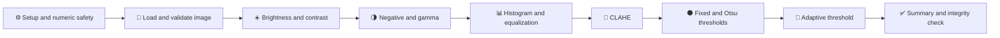
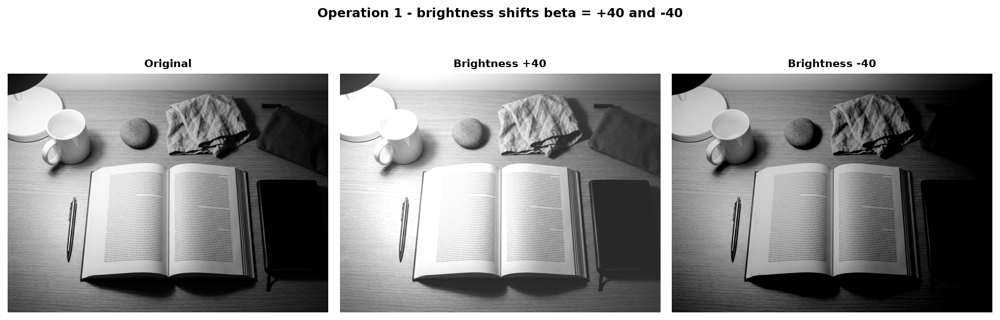
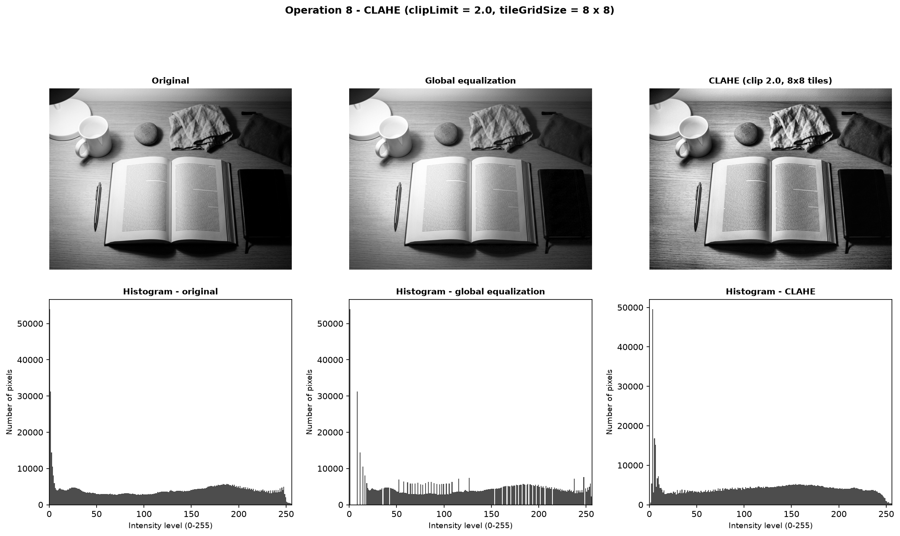
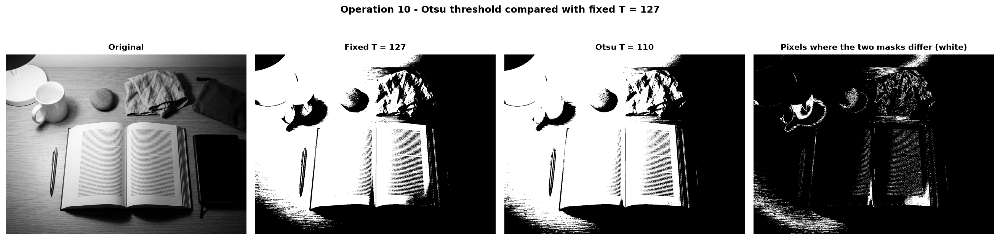
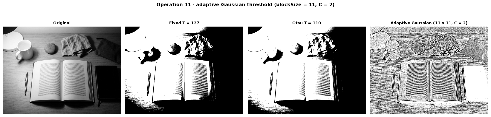

<h1 align="center">🖼️ Digital Image Processing — Lab Task 03</h1>
<h3 align="center">Image Enhancement and Intensity Transformations</h3>

<p align="center">
  
  
  
  
</p>

<p align="center">
  
  
  
  
  
  
</p>

**Name:** Shahzad Ahmed Awan  
**Roll No.:** 2024-SE-15  
**Instructor:** Engr. Fahad Nisar

---

## 📌 Overview

This lab implements and compares grayscale intensity transformations, histogram enhancement, and thresholding using **NumPy**, **OpenCV**, and **Matplotlib**. It includes all eleven prescribed dry runs, typed hand calculations, Python checks, image comparisons, and observations.

The notebook uses `input_image.jpg` as its input. It loads a grayscale `uint8` image of **896 × 1200** pixels, keeps the original unchanged, and displays results over the fixed intensity range 0–255.

---

## 🔄 Workflow



---

## 🗂️ Project Structure

```text
dip-lab-03/
├── .gitignore                     excludes .venv/
├── 2024-SE-15-LAB03.ipynb         completed notebook
├── 2024-SE-15-LAB03.docx          Word lab report
├── 2024-SE-15-LAB03.pdf           optional report preview
├── input_image.jpg                required notebook input
├── lab03_figures/                 20 saved figures for the report and previews
└── README.md
```

The `.venv/` directory is local and should **not** be committed.

---

## 🧰 Requirements

| Item | Version / purpose |
|---|---|
| 🐍 Python | 3.14.8 (notebook kernel) |
| 🔢 NumPy | 2.5.4 |
| 👁️ OpenCV (`opencv-python`) | 5.0.0 |
| 📈 Matplotlib | Create labeled grayscale figures |
| 📓 Jupyter support | `ipykernel` and the VS Code Jupyter extension |

---

## ⚙️ Setup

Run these commands from the `dip-lab-03` folder in PowerShell:

**1. Create and activate a virtual environment**

```powershell
py -3.14 -m venv .venv
.venv\Scripts\Activate.ps1
```

**2. Install the required packages**

```powershell
python -m pip install --upgrade pip
python -m pip install numpy opencv-python matplotlib ipykernel
```

**3. Keep the environment out of Git**

The repository `.gitignore` should include:

```gitignore
.venv/
```

---

## ▶️ How to Run

1. Keep `input_image.jpg` in the same folder as `2024-SE-15-LAB03.ipynb`.
2. Open the `dip-lab-03` folder in VS Code.
3. Open the notebook and select the `.venv` Python kernel.
4. Choose **Restart Kernel → Run All** and keep the code and outputs visible.
5. The notebook creates `lab03_figures/` and saves the figures there (`SAVE_FIGS = True`).

The image must be readable, at least **300 × 300** pixels, and stored as an 8-bit image. The notebook checks the image shape, data type, intensity range, and that the original array remains unchanged.

---

## 🧪 What the Notebook Does

| Step | Task | Main checks and results |
|---|---|---|
| 1 | Setup and numeric safety | Demonstrates `uint8` wrap-around; widens arithmetic, clips to 0–255, then converts to `uint8` |
| 2 | Load and validate image | Confirms file readability, dimensions, grayscale shape, dtype, min/max, and read-only original |
| 3 | Brightness adjustment | Applies β = +40 and −40; compares a nested-loop result with NumPy |
| 4 | Linear contrast from zero | Applies `s = 1.5r`; reports highlight clipping and its mask |
| 5 | Centered contrast | Compares α = 1.5 and α = 0.5 around the fixed pivot 128 |
| 6 | Image negative | Applies `s = 255 − r` and checks that a second negative restores the original |
| 7 | Gamma correction | Compares γ = 0.5 and γ = 2.0; checks the fixed endpoints and truncation rule |
| 8 | Grayscale histogram | Plots a 256-bin histogram and summarizes the image intensity distribution |
| 9 | Global histogram equalization | Computes both dry-run mappings and compares the normalized mapping with OpenCV |
| 10 | CLAHE | Compares local enhancement with global equalization, including dark and bright regions |
| 11 | Fixed thresholding | Applies T = 127; checks binary values and compares the dry-run counts at T = 127 and 180 |
| 12 | Otsu thresholding | Independently checks the maximizing threshold and compares the Otsu and fixed masks |
| 13 | Adaptive Gaussian thresholding | Uses an 11 × 11 neighborhood with C = 2 and compares local and global results |
| 14 | Summary and integrity check | Plots transfer curves, summarizes results, and confirms the original image is unchanged |

Every operation follows the notebook’s sequence: **hand dry run → Python verification → image task → observation**. Arithmetic is widened before clipping, and fractional results are truncated unless the task specifically requests rounding.

---

## 🖼️ Output Preview

The following previews use PNGs created by the notebook. Keep the `lab03_figures/` folder in the repository for these images to appear on GitHub.

<table>
  <tr>
    <th align="center">Brightness adjustment</th>
    <th align="center">CLAHE comparison</th>
  </tr>
  <tr>
    <td align="center"></td>
    <td align="center"></td>
  </tr>
  <tr>
    <th align="center">Otsu thresholding</th>
    <th align="center">Adaptive thresholding</th>
  </tr>
  <tr>
    <td align="center"></td>
    <td align="center"></td>
  </tr>
</table>

| Figure file | Description |
|---|---|
| `a_original.png` | Validated grayscale input |
| `a_numeric_safety.png` | Safe arithmetic and overflow demonstration |
| `c_transfer_curves.png` | Transfer curves for intensity operations |
| `op8_clahe.png` and `op8_regions.png` | CLAHE/global equalization and selected regions |
| `op10_otsu.png` and `op10_threshold_histogram.png` | Otsu mask comparison and threshold locations |
| `op11_adaptive.png` and `op11_local_regions.png` | Adaptive result and local-region comparison |

---

## 📦 Submission

| Item | Include in submission |
|---|---|
| 📓 `2024-SE-15-LAB03.ipynb` (run from a restarted kernel) | ✅ Required |
| 📝 `2024-SE-15-LAB03.docx` | ✅ Required |
| 🖼️ `input_image.jpg` | ✅ Required beside the notebook |
| 📊 `lab03_figures/` | ✅ Keep for report evidence and README previews |
| 📄 `2024-SE-15-LAB03.pdf` | Optional preview copy |
| 🙈 `.venv/` | ❌ Do not submit or commit |
